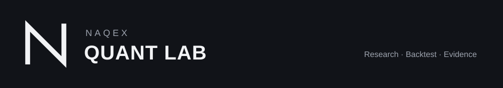
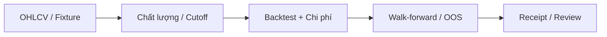

<p align="center"></p>

Nghiên cứu crypto spot khung ngày với backtest có phí, slippage và kiểm tra
ngoài mẫu. Primitive offline giữ provenance, cutoff và receipt tái lập.

[](https://github.com/Naqex/quant-trading/actions/workflows/checks.yml)
[Developer guide](docs/development/README.md) · [Research](docs/research/strategy-report-2026-08-23.md) · [License](docs/licensing.md)



## Bắt đầu

Cần Python 3.12 và [uv](https://docs.astral.sh/uv/). Các lệnh chạy tại gốc repo.

```powershell
git clone https://github.com/Naqex/quant-trading.git
cd quant-trading
uv sync --locked
uv run pytest -q
```

Tải dữ liệu công khai từ Binance, rồi chạy backtest mẫu:

```powershell
uv run quant-lab download --symbol BTCUSDT --start 2018-01-01
uv run quant-lab backtest --symbol BTCUSDT --fast 50 --slow 200 --fee-bps 10 --slippage-bps 5
```

Download cần mạng, không cần API key. Báo cáo lưu tại `reports/`; dữ liệu và báo
cáo local không phải source để commit.

## Bản đồ nghiên cứu

| Nhóm | Nơi đọc / sửa |
|---|---|
| Data, strategy, accounting, metrics, CLI | `src/quant_lab/` |
| Uncertainty, drift, governance, causal diagnostics | `src/quant_trading/` |
| Causal timing, cost, provenance và regression | `tests/` |
| Primitive inventory, nghiên cứu đa tài sản và commands | [Developer guide](docs/development/README.md) |
| Ràng buộc nghiên cứu và hồ sơ người vận hành | [AGENTS.md](AGENTS.md) |

Tín hiệu từ nến `t` chỉ được thực hiện từ nến `t+1`; spot chỉ long/cash,
không leverage. Mỗi chiến lược phải so với benchmark và chi phí trên dữ liệu
ngoài mẫu. Primitive offline không tự mở quyền provider/broker/execution.

Copyright (c) 2026 Naqex. Xem [Naqex Source Available License](LICENSE) và
[chính sách license](docs/licensing.md). Kết quả nghiên cứu không phải
khuyến nghị đầu tư hoặc cam kết lợi nhuận.
